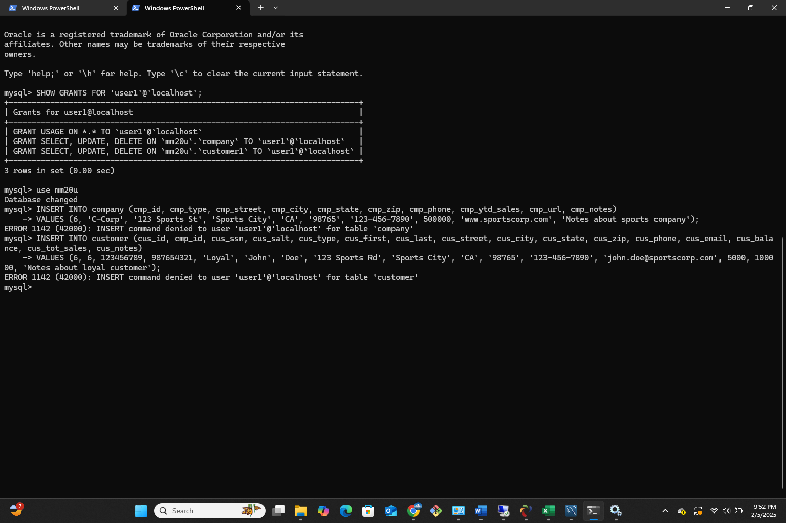
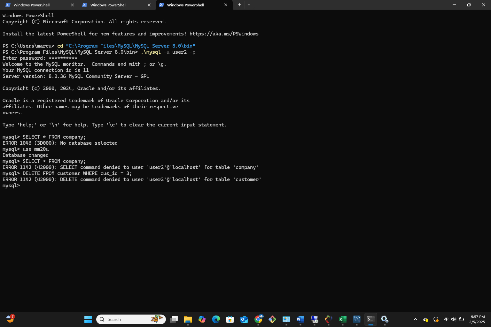
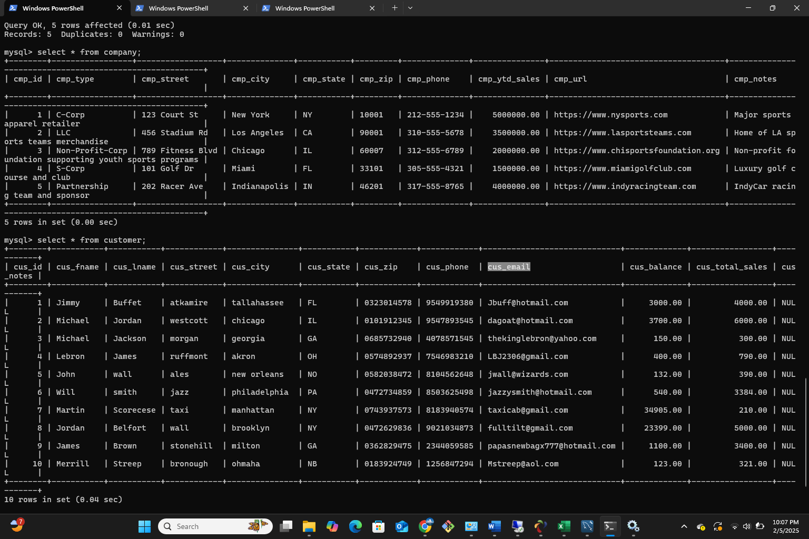
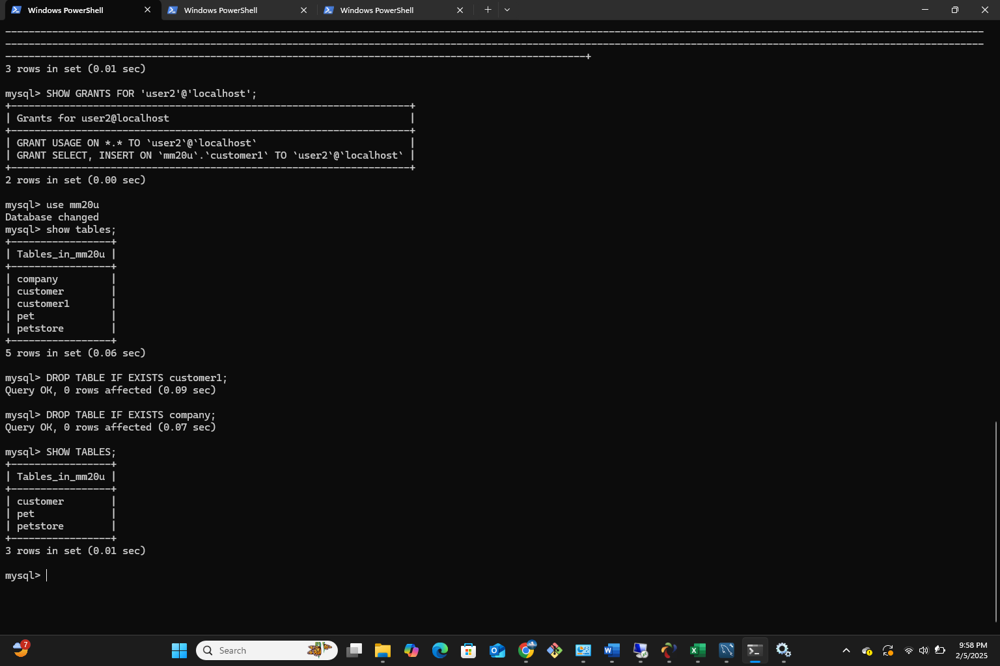

 **NOTE:** This README.md file should be placed at the **root of each of your main directory.**

# Advanced database Management

## Marcus Martin

### Class Number: LIS3781

1. [A1 README.md](lis3781/A1_README.md "My A1 README.md file")
    - Turn off server side validation
    - Establish Database Connection
    - Implement add functionality into database 

2. 1. [A2 README.md](lis3781/A2_README.md "My A2 README.md file")
    - Turn off server side validation
    - Establish Database Connection
    - Implement add functionality into database 

##### User 1 privilege
 
##### User 2 privilege
 
##### Data populated

##### Table Displayed

