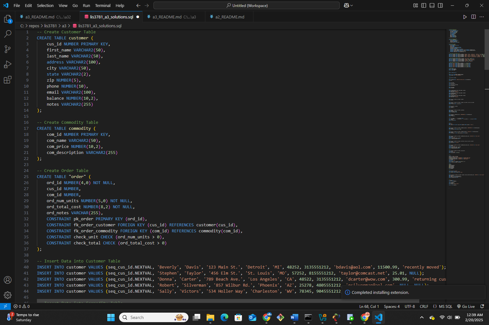
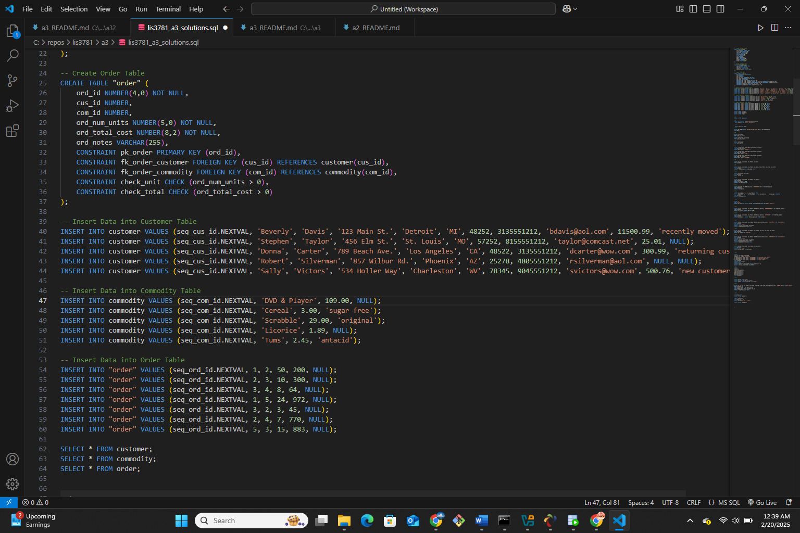
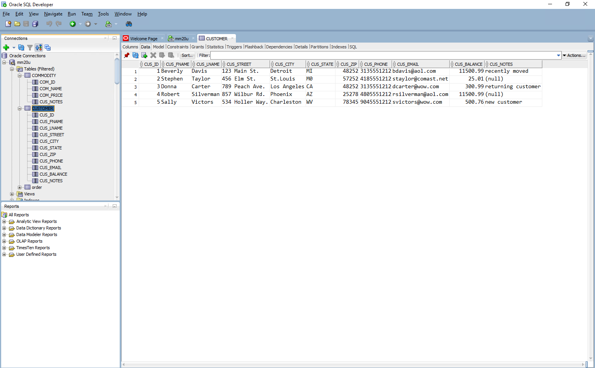
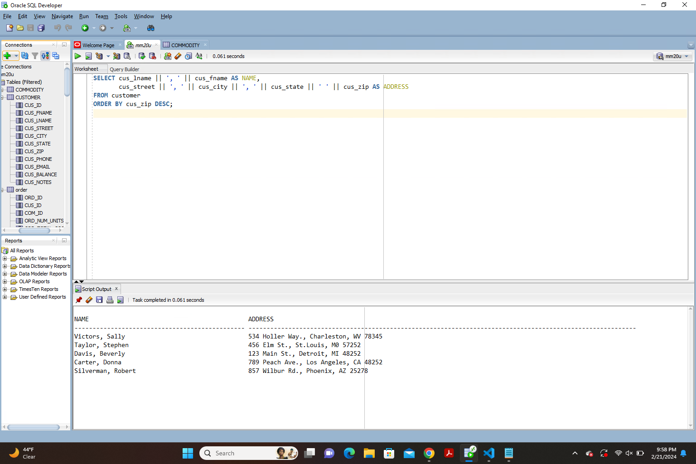

 **NOTE:** This README.md file should be placed at the **root of each of your main directory.**

# Advanced database Management

## Marcus Martin

### Class Number: LIS3781 

1. [A3 README.md](lis3781/A3_README.md "My A3 README.md file")
    - Populate tables using Oracle  sql statement 
    - Format Tables properly 
    - Create SQL script 

[text](lis3781_a3_solutions.sql)
#### Code to make tables 

##### Populated Tables

##### SQL statement with corresponding result 

