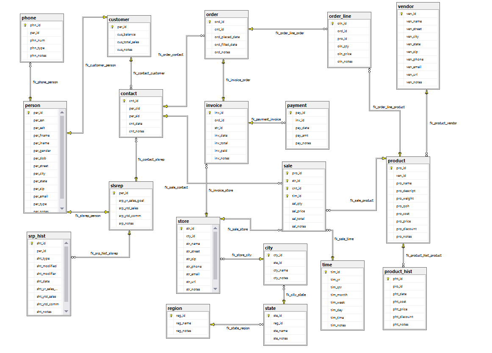
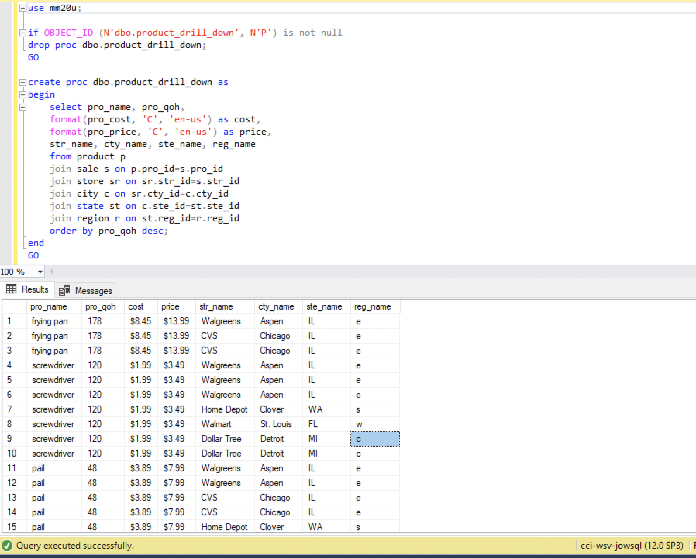

 **NOTE:** This README.md file should be placed at the **root of each of your main directory.**

# Advanced database Management

## Marcus Martin

### Class Number: LIS3781 

1. [A5 README.md](lis3781/A5_README.md "My A5 README.md file")
    - Create Tables using T-SQL
    - Make ERD using MySQL managment 
    - Create stored procedures and triggers

#### LINK to My Solutions
[text](a5_solutions.sql)
#### ERD

##### SQL statement with corresponding result 

