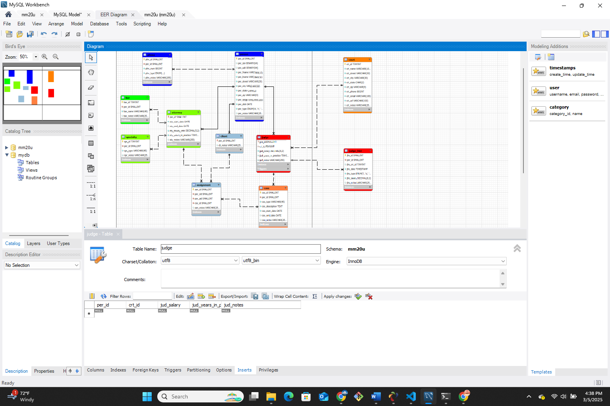
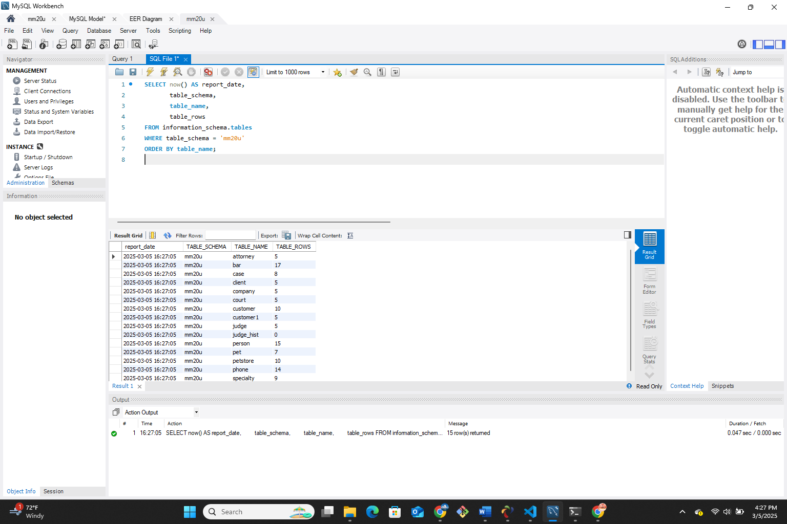

 **NOTE:** This README.md file should be placed at the **root of each of your main directory.**

# Advanced database Management

## Marcus Martin

### Class Number: LIS3781 

1. [P1 README.md](lis3781/p1_README.md "My P1 README.md file")
    - Populate tables using Oracle  sql statement 
    - Format Tables properly 
    - Create SQL script 

#### LINK to My Solutions
[p1_solutions](p1_solutions.sql)
[ERD_file](p1_erd.mwb)
#### ERD Screenshot

#### Populated Tables 

##### SQL Code with report

